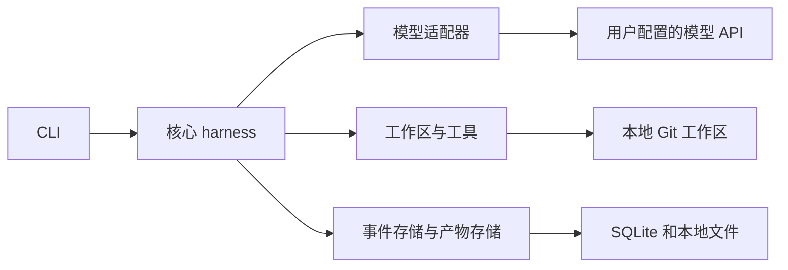

# 技术架构

**状态**　设计，待实现

吉光的首阶段是一条可恢复的本地执行链。CLI 驱动任务执行，核心决定如何推进和是否完成，平台负责模型请求、文件、进程和存储。模块与依赖方向见 [目录结构](repository-layout.md)。实现一条真实模型协议，同时保持核心可以用不同模型配置和协议测试。

## 1. 运行边界

- 每个 Git 工作区同时允许一个吉光运行推进。平台用跨进程的工作区锁协调多个 CLI 实例，核心用预期版本校验事件提交。同一运行串行执行工具，保留工具调用和输出的对应关系。
- CLI 拟提供 `jiguang run`、`jiguang status`、`jiguang resume`。阶段一由前台进程执行并处理取消信号。需要审批或澄清时终止当前 Run，用户提供所需信息后显式恢复。进程失联时先对账，恢复由用户显式发起。任务历史与产物保存于工作区外的本地应用数据目录。
- 一个 Task 保存目标、约束和验收项。一次 Run 固定任务版本、工作区基线引用、模型绑定和预算。一个 Step 承载一轮模型决策与该轮工具结果，可包含多个模型尝试与工具执行。持续写入的模型文本用于显示，正式状态以持久化事件为准。

## 2. 模块与核心接口

以下为接口语义。Rust 具体签名、类型和模块布局随首批纵向功能确定。

| 模块 / 接口 | 输入和输出 | 责任边界 |
| --- | --- | --- |
| `TaskService` / `RunDriver` | 创建、运行、取消、恢复和查询任务；输出状态或结构化运行结论 | 拥有状态转换、预算与推进顺序。恢复创建新 Run，沿用同一 Task 的已提交历史 |
| `ModelAdapter` | `ModelBinding`、归一化上下文、工具定义、预算和取消信号 → 模型事件流 | 映射请求和响应，报告终止原因、用量和协议错误。完整调用集经校验后才进入执行流程 |
| `ContextBuilder` | 任务快照、工作区基线及变更、历史、证据和模型能力 → 请求上下文或 `context_limit` | 选择和裁剪输入，关联产物，建立可检查的输入预算 |
| `Workspace` / `ToolExecutor` | 工作区标识、工具调用、执行策略和预期前置条件 → 结构化结果、产物引用、副作用状态 | 检查路径、文件状态和执行权限，处理文件 I/O 与子进程，报告实际结果 |
| `EventStore` | 任务标识、预期版本、幂等键和事件批次 → 已提交序号；支持按游标读取 | 原子追加事件、更新投影，拒绝版本冲突和重复提交 |
| `ArtifactStore` | 有界字节流、介质类型和元数据 → 可引用的产物 | 保存补丁、日志和报告，可按范围读取，标注截断或缺失 |
| `CompletionPolicy` | 任务版本、工作区指纹、验收项、验证证据和待对账操作 → 通过或缺项清单 | 核对证据适用性和未解决结果；最终状态由 `RunDriver` 提交 |

## 3. 多模型适配

**连接、模型和配置分开。** `ProviderConnection` 表达 API 协议、端点和凭证来源。`ModelBinding` 保存用户选择、连接标识、实际请求模型 ID 及能力配置版本。`ModelCapabilities` 描述窗口大小、输出上限、工具调用及 schema 约束。`ModelProfile` 将模型的参数映射和兼容策略显式化。静态配置给出已知值，适配器报告本次请求的实际用量和错误。凭证仅交给对应适配器，模型输入、工具环境、会话和事件只接收各自所需的数据。

| 归一化信号 | 核心动作 |
| --- | --- |
| 文本增量 | 推送到当前 CLI；成功结束的模型尝试可留下可引用消息 |
| 工具调用片段 | 适配器聚合。整组请求完整且终止状态可信后，校验参数、权限与前置条件，再按顺序执行 |
| 正常结束 | 记录可用用量、停止原因；没有待执行工具时进入完成评估 |
| 断流、输出截断、无效调用 | 保留诊断，丢弃本次未确认的调用；在预算和错误策略允许时重新请求 |
| 限流、网关或连接故障 | 在剩余截止时间内按分类有限重试；永久错误报告给用户 |
| 上下文超限 | 确认可用窗口并尝试一次重新预算；依然无法构造有效请求时记录 `context_limit` |

一个 Run 固定模型。预算同时限制总时间、模型请求数、工具次数、已知 token 消耗和连续无进展回合。每次重试都计入同一预算，单次请求另设截止时间。首阶段重试使用同一模型，用户可在显式恢复时重新选择已支持的模型。协议私有的会话 ID 或继续生成句柄属于适配器命名空间。可重放、可跨模型的任务上下文来自吉光持久化的结构化记录。阶段一需要一个 Responses 真实协议和两组行为不同的 Fake 配置，第二个真实协议留到下一阶段。 [OpenAI Responses 流式事件](https://developers.openai.com/api/reference/resources/responses/streaming-events)

## 4. 上下文管理

每轮从持久快照重建上下文。先计算输入预算，取模型输入上限与“上下文窗口减去输出保留和安全余量”之间的较小值。序列化后的完整请求都计入预估，包括工具 schema 和协议封装。估算方法、模型回报的实际用量与预算分别记录。

1. **稳定前缀**保留项目指令、任务目标及约束、权威的当前验收项、工具契约。工作区只读取信任策略允许的指令文件。
2. **当前进展**保留当前计划、已变更路径、最新错误、有效验证结果和待完成项，带任务版本或文件快照引用。
3. **工作证据**选择当前步骤相关片段、最近必要操作及配对的工具调用与结果。大输出存产物，发送给模型的是预览和可回读引用。产物记录原始采集、存储和展示各层的截断状态；用文件读取工具读取任务产物引用时走独立只读路径。
4. **压缩顺序**先减少较旧的文件片段、移除冗余结果及缩短可回读预览，再淘汰较老且已结清的操作对。强制项超限时上报 `context_limit`。首阶段采用确定性压缩，减少一次额外的模型调用及由摘要遗失信息的风险。

Copilot 关于逐步加载与缩减工具输出的经验用于这里的预算设计。后续可用固定任务集验证同步摘要带来的完成率和开销变化，再决定是否加入异步摘要、工具发现或索引检索。 [GitHub Copilot 的上下文与工具输出实践](https://github.blog/ai-and-ml/github-copilot/how-we-make-ai-coding-more-cost-efficient-without-sacrificing-task-quality/)

## 5. 工具、副作用与恢复

| 工具 | 约定 |
| --- | --- |
| `read_file` | 按路径和范围读取文件，返回读到的内容及文件指纹；支持按行回读本任务产物 |
| `search` | 在工作区内有界搜索，返回相对路径与行范围 |
| `apply_patch` | 处理前检查目标路径及预期原文或文件指纹。记录补丁和各路径结果，多文件写入按实际结果对账 |
| `write_file` | 对新建文件校验不存在，对覆盖校验当前指纹，在同目录暂存后替换 |
| `run_command` | 结构化参数和工作目录，受权限策略、超时、输出上限和取消信号约束；返回退出状态及标准输出、标准错误的引用 |

平台解析路径并检查可写范围，保留用户已存在的变更。目标改变或工作区冲突时暂停并报告，自动执行流程不提交、重置或暂存用户改动。命令以工作区为当前目录。内置 Git 查询与搜索走各自的工具约束；`run_command` 仅执行用户为本次任务批准或配置允许的命令参数组合，其他请求生成待授权项。启动进程时从精简环境构造子进程变量。命令获得当前用户权限，工作目录与路径检查不能隔离其访问的文件或网络；OS 沙箱作为后续独立能力。命令取消会尝试终止其进程组并等待确认，无法确认时记录待对账状态。

执行副作用前已提交 `tool.started`，包含唯一执行 ID、目标与预期前置条件。完成后持久化结果及产物引用。SQLite 事务与外部写入分开，产物先暂存并发布，再在事件中引用。如果进程在两者之间退出，恢复先检查工作区、记下的前置和预期结果及可确认的进程状态。能确认的文件效果作为恢复证据追加。无法判断时转为 `blocked` 并请用户处理。带副作用的调用在未知状态下禁止自动重放。取消、超预算和中断均保留最近已知位置，恢复后重新评估仍适用的证据。

## 6. 事件模型

事件按任务分流，持久信封含 `schema_version`、`event_id`、`task_id`、`seq`、`occurred_at`、`kind` 和类型化 `payload`，按需带 `run_id`、`step_id`、`attempt_id` 或 `execution_id`。`seq` 为任务内递增序号。运行投影和事件追加使用同一短事务。CLI 重连可按持久游标重放，进度文本和 token 增量走独立的即时通道。

| 事件 | 主要内容 |
| --- | --- |
| `task.created`、`task.revised` | 目标、约束、验收项和版本 |
| `run.started`、`run.cancel_requested` | 基线、模型绑定、预算、恢复来源或取消原因 |
| `step.started`、`model.attempt_started`、`model.attempt_finished` | 当前步骤、尝试号、请求契约摘要、结束原因、使用量及错误分类 |
| `tool.started`、`tool.finished`、`tool.reconciled` | 工具执行意图、实际结果、产物、已观测或未知的副作用 |
| `verification.recorded` | 验收项、验证方式、退出状态、适用输入或文件指纹、证据引用 |
| `completion.requested`、`completion.evaluated` | 完成候选来源、对应任务版本、工作区指纹和通过或缺项理由 |
| `run.settled` | 终局、原因、阶段性结果、待对账项和下一步 |

Task 投影表示当前任务可继续、暂停或已经完成，Run 保存自身终局，模型停止原因归 ModelAttempt。Run 终局包括 `completed`、`needs_input`、`blocked`、`budget_exhausted`、`cancelled`、`interrupted`、`failed`、`progress_stalled`，详细原因可含 `context_limit`。失败日志与产物有级别和大小限制，持久事件保留可诊断的结果与错误分类。

## 7. 完成判定

用户目标和约束形成带 ID 的验收项，任务版本改变后按新版本检查。模型可以明确提出交付；模型自然停止且无待执行工具时也形成候选。终局由运行时提交。

1. 检查是否需要用户提供信息，以及是否有待执行、待确认的副作用。需要输入或对账时进入对应终局。
2. 对照验收项检查报告、修改结果、验证命令和产物。按任务类型确定证据。文档任务可以凭文件及内容检查完成，代码修改按相关验证命令和结果评估。验证命令及通过条件由用户约束、项目验证入口或任务方案明确。运行时核对实际命令、退出状态和产物。调用失败或验证被跳过时保留原因，强制验收项继续待办。
3. 以任务版本和工作区指纹绑定验证证据。指纹涵盖验收涉及的路径及验证能声明的输入，关键输入无法穷举时在提交完成前重新验证。提交时再检查任务版本和最新工作区状态。发现冲突后重新评估，完成报告指明证据对应的快照。
4. 有缺项且还能推进时，反馈具体缺项并允许最多两轮补齐，每轮消耗正式预算。对工作区、证据和待完成项均无进展的重复回合判为 `progress_stalled`。预算耗尽保留已完成内容、缺失证据和可恢复位置。
5. 完成输出列明交付、相关路径、实际运行的验证及未解决事项。质量仍用独立任务验证器衡量，避免把通过 harness 的完成规则当成任务正确率。

## 8. 第一阶段开发计划

| 顺序 | 工作包 | 可核验交付 |
| --- | --- | --- |
| 1 | 锁定边界和领域契约 | 定义 Task、Run、Step、验收项、终局及两组脚本化模型行为 |
| 2 | 事件存储和产物 | 按游标重放生成同一投影；覆盖版本冲突、重复提交和产物引用完整性 |
| 3 | Git 工作区和五种工具 | 覆盖用户已有变更、指纹冲突、部分写入、输出上限和命令取消 |
| 4 | 模型层和协议 | Fake 与 Responses 走同一语义；模拟断流、限流、无效参数及超限，确保半截请求没有写入 |
| 5 | 执行循环、上下文和 CLI | 从同一入口跑通读取、修改、验证；预算与事件可见，两组 Fake 配置复用核心 |
| 6 | 完成门槛 | 验证失败、证据陈旧、只做一半或循环无进展时，CLI 输出准确终局和缺项 |
| 7 | 中断和显式恢复 | 在调用断流、写前、写后事件提交前、验证中断的位置注入故障，对账后续跑或阻塞，不重复副作用 |
| 8 | 评估与交付 | 候选版本可运行、可复现实验，交付指标基线及失败分类 |

建立 **20 个**可重复任务的首轮评估集。规划 6 个修复、6 个功能、4 个跨文件任务、4 个中断恢复任务。14 个用于开发迭代，6 个作保留集。每题从固定的 Git 快照启动，运行预算、模型配置、允许工具和验收规则单独记录。外部验收独立运行，评估夹具和验证器放在 agent 读取范围之外。常规测试使用 Fake Provider 与临时仓库，真实 API 只在显式评估时调用。指标定义见 [项目愿景](vision.md)。

首阶段交付一个可靠的 CLI 执行链。第二个真实模型协议、工作台、MCP、Skills、LSP、后台摘要、自动模型路由、独立评审、多 agent 及 OS 沙箱分别推进，依据是明确需求与基线暴露的失败。
